# Telegram Memo

A **send-only memory capture app** for Android. Take a photo with the front or back camera, add a short note, and the app automatically attaches **where** and **when** the photo was taken. Everything is sent to your own private Telegram channel, which works as your diary, storage, backup and viewer.

Built with **.NET MAUI (.NET 10, `net10.0-android`)** and C#.

- The app **never reads memos back** from Telegram. There is no history screen.
- With no internet (or before Telegram is set up), memos are saved on the phone in a queue and sent later, **oldest first**.

This README is the full specification of the app: features, screens, behavior, data model, Telegram integration, build, and test checklist.

---

## Contents

1. [Screenshots](#1-screenshots)
2. [Features](#2-features)
3. [Setting up Telegram](#3-setting-up-telegram)
4. [Build, run and install](#4-build-run-and-install)
5. [Tech stack](#5-tech-stack)
6. [Project structure](#6-project-structure)
7. [Screens](#7-screens)
8. [Behavior spec](#8-behavior-spec)
9. [Android manifest](#9-android-manifest)
10. [App icon and splash](#10-app-icon-and-splash)
11. [Rules and constraints](#11-rules-and-constraints)
12. [Manual test checklist](#12-manual-test-checklist)
13. [Security notes](#13-security-notes)
14. [Out of scope](#14-out-of-scope)

---

## 1. Screenshots

Taken on the Android emulator (Pixel 7, Android 16, light system theme). The emulator's cameras show synthetic test scenes.

| | | |
|---|---|---|
| 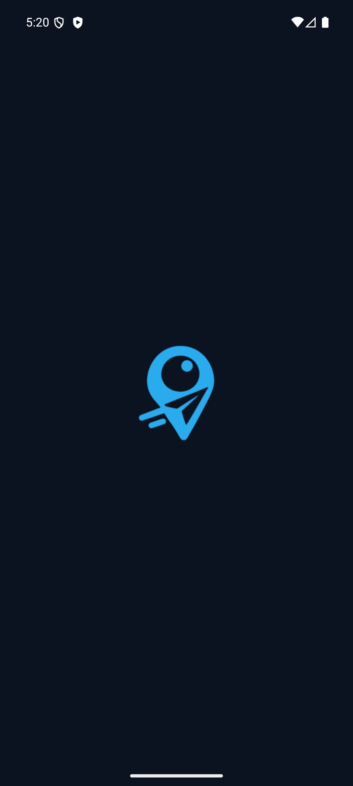<br>Splash | 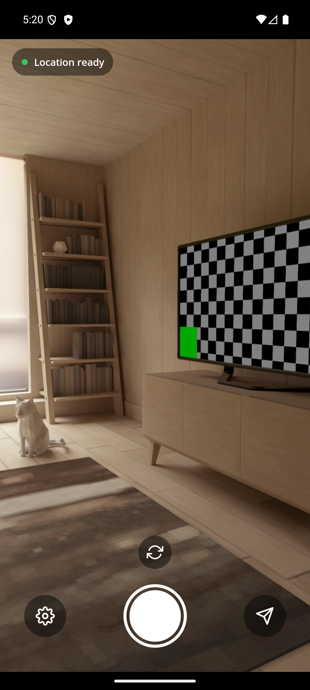<br>Camera (rear), location ready | 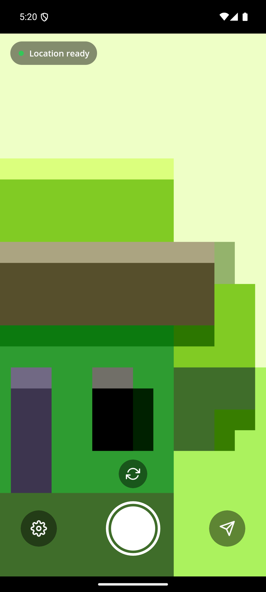<br>Camera (front) |
| 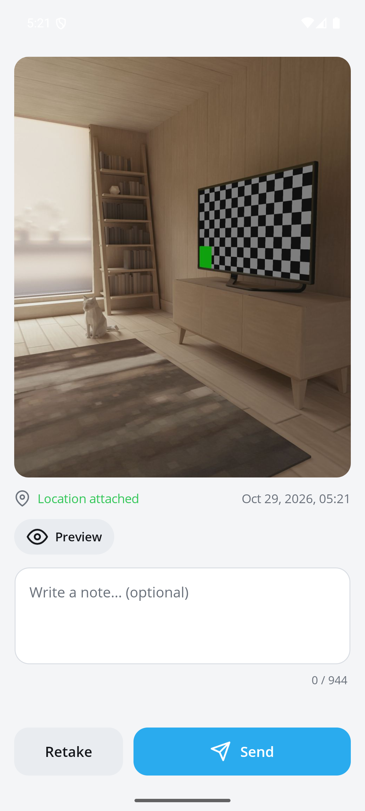<br>Review | 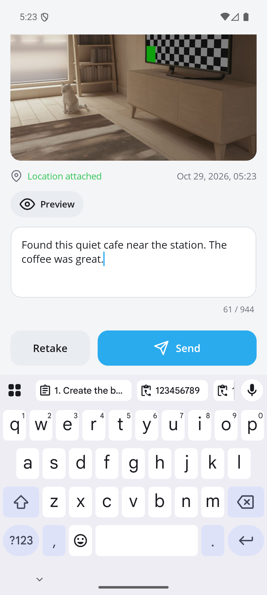<br>Send stays above the keyboard | 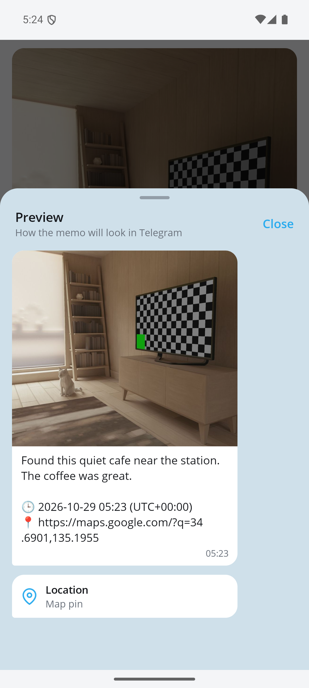<br>Telegram-style preview |
| 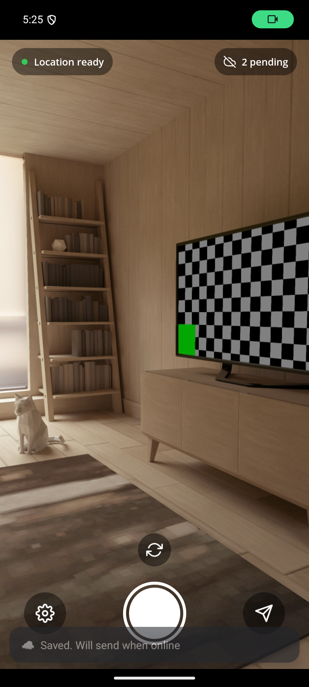<br>Saved toast + pending badge | 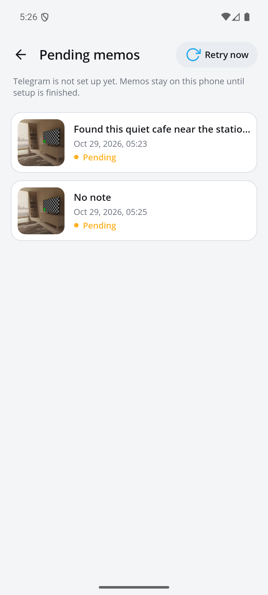<br>Pending memos | 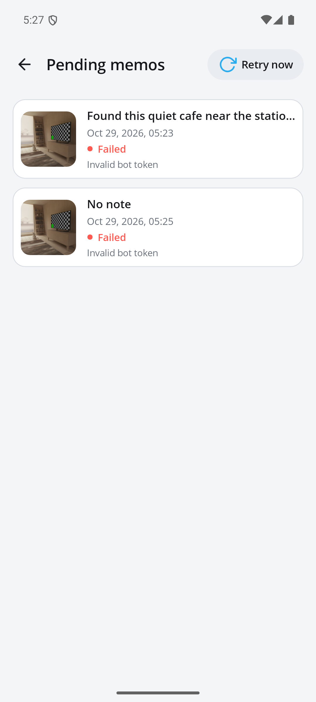<br>Failed with reason |
| 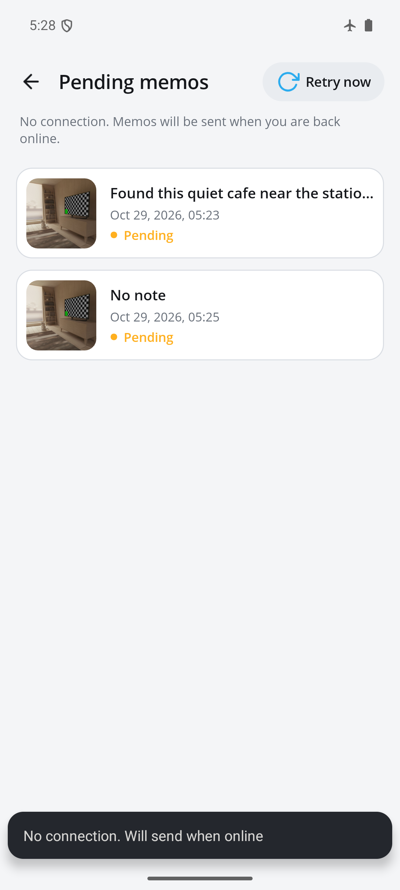<br>Retry while offline | 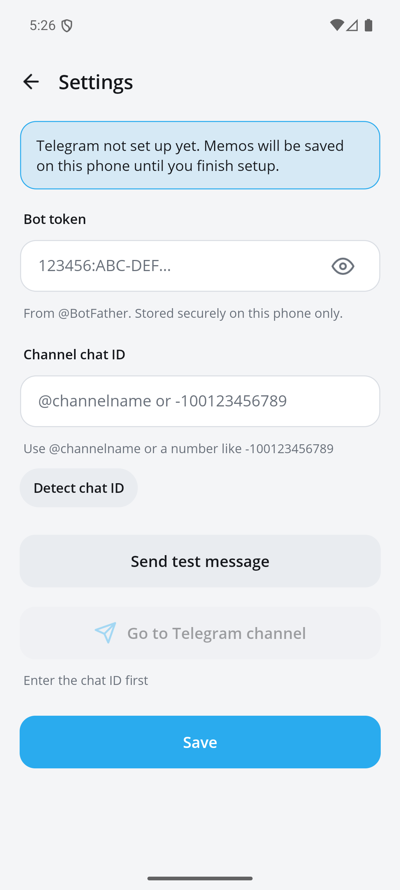<br>Settings, first run | 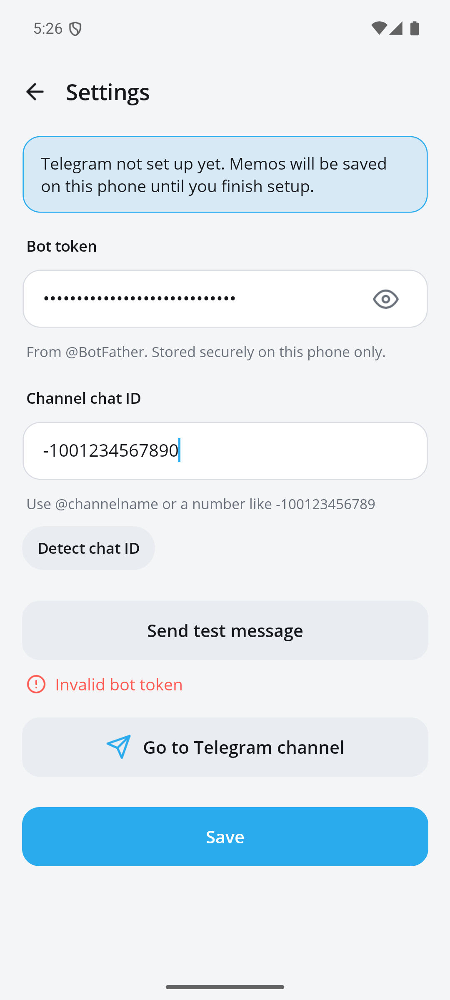<br>Test message error |
| 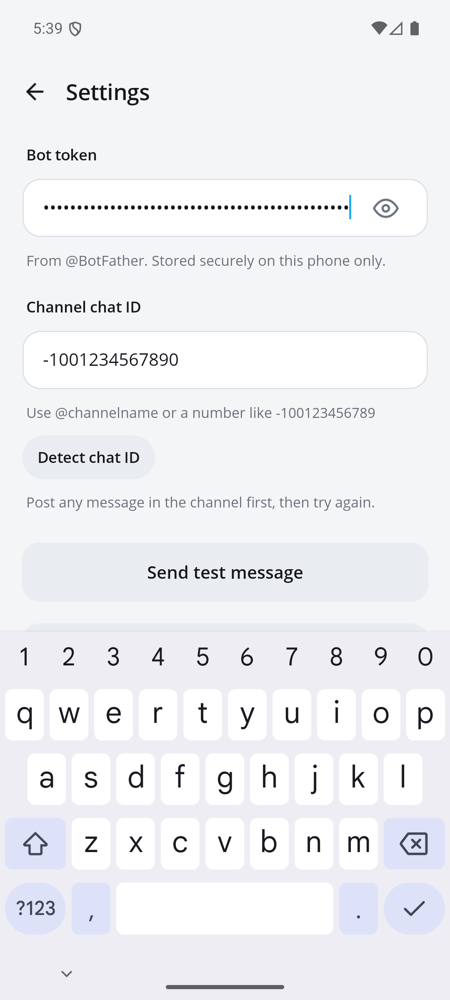<br>Detect chat ID, no posts yet | 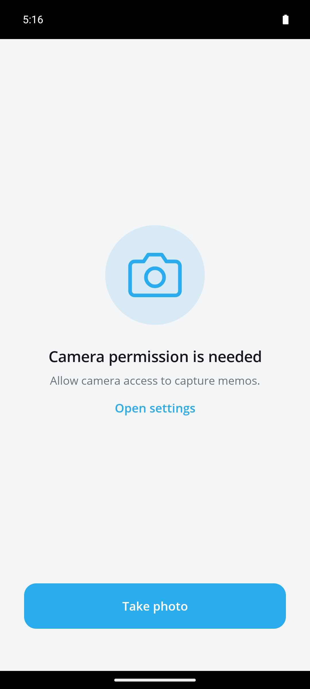<br>Camera permission fallback | |
| 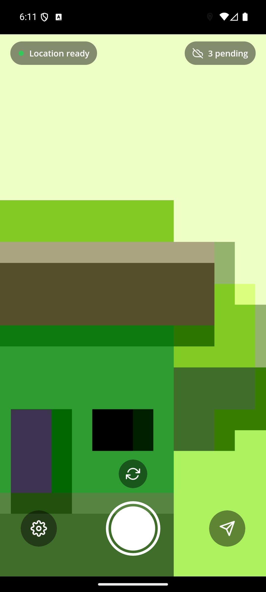<br>Front camera live preview | 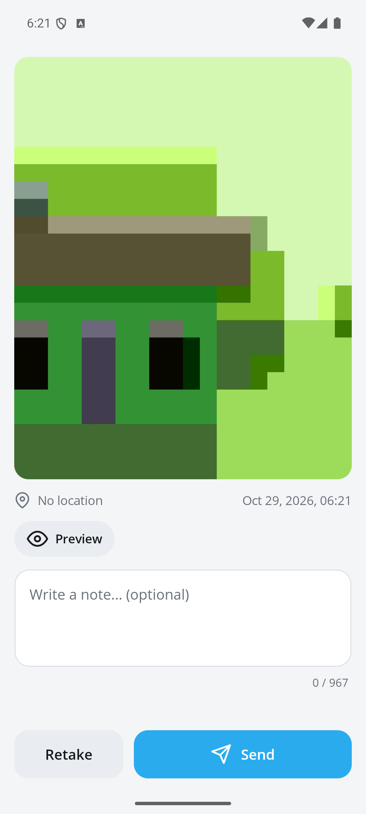<br>Saved front photo, mirrored to match | |

---

## 2. Features

- Camera-first: the app opens straight to the camera, with **front/back switching** (last used camera is remembered)
- Location and capture time are recorded **at the moment of the shot**, not when you press Send
- Optional text note, with a preview of exactly how the message will look in Telegram
- Sends photo, note, time, Google Maps link and a real map pin through the Telegram Bot API
- **Offline queue:** memos are saved locally and sent later in the original order, with automatic retries
- Pending screen with status (Pending / Sending / Failed with reason) and "Retry now"
- One-tap button that opens your channel in the Telegram app
- Dark design, light theme supported (follows the system setting)

### How a memo looks in Telegram

```
Found this quiet cafe near the station. The coffee was great.

🕒 2026-10-29 14:32 (UTC+09:00)
📍 https://maps.google.com/?q=34.6901,135.1955
```

The photo is posted with this caption, followed by a map pin. Notes too long for the caption (1024 characters) are sent as a separate message.

---

## 3. Setting up Telegram

The app works fully without Telegram (capture, review, queue). Memos wait in the queue until setup is finished.

1. In Telegram, open **@BotFather**, send `/newbot`, follow the steps, and copy the **bot token**.
2. Create a **private channel**.
3. Open the channel → **Administrators** → **Add Administrator**, choose your bot, allow it to post messages.
4. Post any message in the channel (needed for chat ID detection).
5. In the app, open **Settings**:
   - Paste the **bot token**.
   - Tap **Detect chat ID**, or type it: `@channelname` for a public channel, or a number like `-1001234567890` for a private one.
   - Tap **Send test message** and check that it appears in the channel.
   - Tap **Save**. Waiting memos are sent automatically.

The token and chat ID are stored only on the phone (the token in secure storage). They are never part of the source code.

---

## 4. Build, run and install

Requirements: Visual Studio 2026 (or later) with the **.NET Multi-platform App UI** workload, the .NET 10 SDK, the Android SDK, and an Android phone (camera and GPS need a real device) or an emulator.

```bash
# Debug build
dotnet build -f net10.0-android

# Build, deploy and launch on a connected device/emulator
dotnet build -t:Run -f net10.0-android

# Release APK (bin/Release/net10.0-android/publish/*-Signed.apk)
dotnet publish -f net10.0-android -c Release
```

A ready Release build is in the repo root as `TelegramMemo.apk`. It is signed with the default debug keystore, which is fine for sideloading on your own phone. For distribution, create your own signing keystore and keep it out of source control.

Install: `adb install -r TelegramMemo.apk`, or copy the APK to the phone and open it.

> **Uninstall the old app first** when the icon changed: Android caches launcher icons. Uninstalling also deletes memos still waiting on the phone.

---

## 5. Tech stack

| Area | Choice |
|---|---|
| Framework | .NET MAUI, `net10.0-android` only, C# |
| Pattern | MVVM with `CommunityToolkit.Mvvm` source generators (partial properties), DI in `MauiProgram.cs` |
| Camera | `CommunityToolkit.Maui.Camera` (`CameraView`): app-controlled preview, shutter and front/back selection |
| UI helpers | `CommunityToolkit.Maui` (Snackbar, IconTintColorBehavior, StatusBarBehavior, converters) |
| Location | `Microsoft.Maui.Devices.Sensors.Geolocation` |
| Network state | `Microsoft.Maui.Networking.Connectivity` |
| Local queue | SQLite via `sqlite-net-pcl` (bundles its own native SQLite; `SQLitePCLRaw.bundle_green` is not used because its current version pulls in a vulnerable native library). Photos are files in `FileSystem.AppDataDirectory/photos/` |
| Secrets | `SecureStorage` for the bot token; `Preferences` for chat ID, last-used camera and last sent message id |
| HTTP | One shared `HttpClient` (60 s timeout) via DI, `System.Text.Json` |

Package versions: `CommunityToolkit.Maui` 15.0.1, `CommunityToolkit.Maui.Camera` 6.1.0, `CommunityToolkit.Mvvm` 8.4.2, `sqlite-net-pcl` 1.11.285, `Microsoft.Maui.Controls` 10.0.120.

---

## 6. Project structure

```
Telegram Memo App/
├─ Models/        MemoItem.cs, MemoStatus.cs
├─ Services/
│   ├─ TelegramService.cs     sendPhoto, sendMessage, sendLocation, getUpdates, error mapping
│   ├─ QueueService.cs        SQLite CRUD, serial processing, backoff, triggers
│   ├─ LocationService.cs     warm fix, freshest fix at shutter
│   ├─ ImageService.cs        EXIF orientation, front-camera mirror, resize, JPEG
│   ├─ SettingsService.cs     SecureStorage / Preferences, IsConfigured, channel links
│   ├─ ChannelLauncher.cs     the one "open channel" helper + ITelegramAppLauncher
│   ├─ CaptionBuilder.cs      caption text, splitting rules, display time
│   └─ AppServices.cs         CaptureSession, Toasts (snackbar), Routes
├─ ViewModels/    CameraViewModel, ReviewViewModel, PendingViewModel, SettingsViewModel
├─ Views/         CameraPage, ReviewPage, PendingPage, SettingsPage
├─ Resources/
│   ├─ Styles/    Colors.xaml, Styles.xaml (all colors and styles; no inline colors)
│   ├─ Images/    line icons (SVG) and illustrations
│   ├─ AppIcon/   appicon.png (background), appiconfg.png (logo foreground)
│   └─ Splash/    splash.png
├─ Platforms/Android/
│   ├─ AndroidManifest.xml
│   ├─ MainActivity.cs           portrait lock, soft input
│   └─ TelegramAppLauncher.cs    tg:// ACTION_VIEW intent
├─ screenshots/
├─ TelegramMemo.apk
└─ MauiProgram.cs   DI, UseMauiCommunityToolkit(), UseMauiCommunityToolkitCamera()
```

Navigation uses Shell routes. `CameraPage` is the start page; `review`, `settings` and `pending` are pushed on top of it. The Shell nav bar is hidden; pages draw their own headers.

---

## 7. Screens

**Visual style:** clean and minimal. Dark design by default (near-black `#0E0F12` background, soft off-white text), one accent color **Telegram blue `#2AABEE`**, 16 px rounded corners, large touch targets, generous spacing, simple line icons. Light mode via `AppThemeBinding`, following the system setting. Colors and styles live in `Resources/Styles`.

### 7.1 CameraPage (start page)
- Full-screen live camera preview (CameraX `PreviewView` set to fill).
- Top left: location chip: "Getting location..." (spinner), "Location ready" (green dot), "No location" (muted).
- Top right: pending badge (cloud-off icon + count, e.g. "3 pending"), visible only when the queue has unsent items. Tap opens PendingPage.
- Bottom center: large round shutter button. Bottom left: settings gear. Bottom right: paper-plane button that opens the channel (8.8).
- Camera switch button (front/back): small round icon button just above the shutter. Hidden when only one camera exists.

### 7.2 ReviewPage (after the shot)
- Large photo at the top with rounded corners.
- Info row: pin icon + "Location attached" (green) or "No location" (muted) + capture time, e.g. "Oct 29, 2026, 14:32". Read-only.
- "Preview" button (eye icon) opens a bottom sheet with a Telegram-style bubble: the photo and caption exactly as they will be sent, extra message bubbles for a long note, and a map-pin bubble when a location exists.
- Multiline note box, placeholder "Write a note... (optional)", character counter `n / budget` (budget = 1024 minus the footer length); above the budget it shows "long note, sent as a separate message".
- Buttons: secondary **Retake**, primary **Send** (accent). The page resizes with the keyboard so Send is never hidden. Hardware back = Retake.

### 7.3 Toast after Send
- Online and configured: "✓ Sent to Telegram" with an **Open** action that opens the channel.
- Offline, not configured, or not delivered within 60 s: "☁ Saved. Will send when online" (no action).
- The app returns to the camera immediately; the toast appears there once the result is known.

### 7.4 PendingPage ("Pending memos")
- Back arrow, "Retry now" button, a hint line when not configured or offline.
- Cards: thumbnail, first line of the note (or "No note"), capture time, status label (Pending / Sending / Failed) and a short reason (e.g. "Invalid bot token", or the last transient error with retry count).
- Empty state: illustration, "All memos sent", "View in Telegram" button.

### 7.5 SettingsPage
- First-run banner while not configured: "Telegram not set up yet. Memos will be saved on this phone until you finish setup."
- "Bot token" (masked, show/hide eye icon).
- "Channel chat ID" with helper "Use @channelname or a number like -100123456789", plus **Detect chat ID**.
- **Send test message** with result states: success (green check, "Test message sent") or error (red, with reason, 8.7).
- **Go to Telegram channel** (full width, paper-plane icon). Disabled with helper "Enter the chat ID first" while the chat ID is empty.
- **Save**.

### 7.6 Camera fallback state (on CameraPage)
- Shown when camera permission is denied or no camera is available: illustration, "Camera permission is needed" (or "No camera available"), an "Open settings" link (`AppInfo.ShowSettingsUI()`), and a large "Take photo" button that asks for permission again. Returning from Android settings re-checks automatically.

The Figma "Telegram preview" full-screen mock is a design aid only and is not built; the paper-plane and "Go to Telegram channel" buttons open the real Telegram app.

---

## 8. Behavior spec

### 8.1 Camera and front/back switching
- `Permissions.Camera` is requested on first use. Denied or permanently denied shows the fallback state (7.6).
- `ICameraProvider` lists cameras; the switch toggles between rear and front. The last used camera is stored in `Preferences`.
- The `CameraView` is created in code only after permission is granted (its handler connects to the camera immediately).
- The preview starts when CameraPage appears and **stops when it disappears**, releasing the camera while Review, Settings or Pending is shown.
- Saved photos are upright: the camera JPEG's EXIF orientation is applied to the pixels.
- **Front-camera photos are saved mirrored** (flipped horizontally) so they look exactly like the live preview; back-camera photos are unchanged. CameraX returns front photos unmirrored, so the app flips them — once, at capture time, right after the EXIF orientation fix and before compression. The flip is skipped if the EXIF orientation already contains a mirror (flip/transpose/transverse), so a photo is never double-flipped. Queue processing and retries never touch the image: the file saved at capture time is the single source for Review, the queue and the upload.
- The app is locked to portrait.

### 8.2 Location at the moment of the shot
- `Permissions.LocationWhenInUse` is requested when CameraPage first opens (after the camera prompt).
- While CameraPage is visible, a fix is kept warm: `Geolocation.GetLocationAsync` (medium accuracy, 8 s timeout) every 5 s, seeded by the last known location. This drives the chip ("No location" after repeated failures, permission denied, or location switched off).
- At the shutter, the freshest fix no older than 60 s is used. If none, one quick request (3 s). If still none, the memo is saved **without** a location — not an error.
- Latitude, longitude and capture time (UTC) are stored **at shutter time**, not at send time.

### 8.3 Local data model (SQLite table `MemoItem`, `AppDataDirectory/memos.db3`)

| Field | Notes |
|---|---|
| Id | auto-increment primary key |
| Text | note, may be empty |
| PhotoPath | required, file inside `AppDataDirectory/photos/` |
| Latitude, Longitude | nullable |
| CapturedAtUtc | capture time (UTC) |
| Status | Pending, Sending, Failed (sent rows are deleted) |
| PhotoSent, TextSent, LocationSent | step flags so a retry never re-sends a step that already succeeded |
| RetryCount, LastError, NextAttemptUtc | backoff and the pending list |

### 8.4 Saving and queue processing
- At capture, the photo is normalized (orientation, mirror for front camera, longest side 1600 px, JPEG quality 80) into the cache. Pressing Send **always** saves to the queue first (move the photo into `photos/`, insert the row), even when online — one code path for online and offline.
- `QueueService` processes **serially** (one pass at a time, guarded by a lock) and **oldest first**, so the channel stays in chronological order. It does not skip ahead of an item that is waiting for its backoff.
- Triggers: right after saving, `Connectivity.ConnectivityChanged` to online, app resume, Settings save, and "Retry now".
- On app start, any row stuck in `Sending` is reset to `Pending` (crash recovery). Leftover unsent captures in the cache are deleted.
- If Telegram is not configured or there is no internet, items stay `Pending` and the network is not called.
- Error handling:
  - Transient (no network, timeout, HTTP 5xx): stay `Pending`, increment `RetryCount`, backoff 5 s, 30 s, 2 min, 10 min, then every 10 min. A timer wakes the queue when the wait is over.
  - HTTP 429: wait the `retry_after` seconds Telegram returns.
  - Permanent (400, 401, 403, 404 — wrong chat ID, bad token, bot not admin): mark `Failed`, store a readable `LastError`, **no** auto-retry. "Retry now" or saving Settings re-queues them. Later items are still sent.
- The row and the local photo are deleted only after Telegram confirms `ok: true` for every step.
- Telegram has no deduplication, so each step flag is saved immediately after its `ok: true`.

### 8.5 Telegram Bot API calls
Base URL `https://api.telegram.org/bot{token}/{method}`. Plain text, no `parse_mode` (no escaping needed; Telegram auto-links URLs).

- `sendPhoto`: multipart form with `chat_id`, `photo` (file), `caption`.
- `sendMessage`: `chat_id`, `text`.
- `sendLocation`: `chat_id`, `latitude`, `longitude` (only when a location exists).
- `getUpdates`: used only by "Detect chat ID".
- Every response is JSON with `ok`. On `ok: false` the app reads `error_code`, `description` and `parameters.retry_after`. On success of `sendPhoto`/`sendMessage`, `result.message_id` is read and stored (8.8).

### 8.6 Message format
- Caption = note (trimmed, if any) + blank line + footer:
  - `🕒 yyyy-MM-dd HH:mm (UTC±HH:mm)` — the **capture time** in the phone's local time zone.
  - `📍 https://maps.google.com/?q=<lat>,<lon>` (up to 6 decimals), or `📍 Location unavailable`.
- Caption limit 1024 characters. If note + footer is longer, the photo is sent with the footer only, then the **full note** as separate `sendMessage` messages (limit 4096 each, split at a newline or space when possible, never inside an emoji).
- Order per memo: `sendPhoto` → (optional) `sendMessage` for a long note → `sendLocation` (map pin).

### 8.7 Settings behavior
- Token → `SecureStorage`; chat ID → `Preferences`. On save the chat ID must be `@username` or a number starting with `-100` (empty is allowed and means "not configured").
- **Send test message** sends "Telegram Memo test" via `sendMessage` with the values currently typed. Error mapping: 401/404 → "Invalid bot token"; 400 "chat not found" → "Chat not found"; 403 or "not enough rights" → "Bot is not an admin of the channel"; network failure → "No connection".
- **Detect chat ID** calls `getUpdates` with the typed token and fills in the newest `channel_post.chat.id` (or `message.chat.id` for groups, or `my_chat_member.chat.id` when the bot was just added). If nothing is found: "Post any message in the channel first, then try again."
- After Save, `Failed` items are re-queued and processing starts.

### 8.8 Opening the Telegram channel
Used by the camera paper-plane button, the toast "Open" action, the Settings "Go to Telegram channel" button and the empty-state "View in Telegram" button. All four go through one shared helper, `ChannelLauncher.OpenAsync`; the Android intent code sits behind the small `ITelegramAppLauncher` interface (`Platforms/Android/TelegramAppLauncher.cs`).

1. Chat ID empty (not configured) → go to Settings.
2. **Open the Telegram app with a `tg://` deep link**, started as an Android `ACTION_VIEW` intent with the `NewTask` flag and **no package restriction** (so Telegram X and other clients work too):
   - `@name` → `tg://resolve?domain=name`
   - `-100<digits>` (private channel; `<digits>` = the id without `-100`):
     - if the id of the last message the app sent successfully to that chat is known → `tg://privatepost?channel=<digits>&post=<lastMessageId>`
     - otherwise → `tg://openmessage?chat_id=<digits>`
   - The last `message_id` comes from each successful `sendPhoto`/`sendMessage` (queue and test message) and is stored in `Preferences` together with its chat ID, so changing the channel never opens a post from the old one.
3. If starting the intent fails (e.g. `ActivityNotFoundException`, no Telegram app) → `Launcher.OpenAsync` with `https://t.me/name` or `https://t.me/c/<digits>`.
4. If that also fails → short message "Telegram app not found".

---

## 9. Android manifest

- Permissions: `INTERNET`, `ACCESS_NETWORK_STATE`, `CAMERA`, `ACCESS_FINE_LOCATION`, `ACCESS_COARSE_LOCATION`.
- `uses-feature` for camera, front camera, autofocus, location and GPS, all `android:required="false"`.
- `<queries>` for `VIEW` intents with the `tg` and `https` schemes (Android 11+ package visibility).
- Cleartext traffic disabled. Portrait only (`MainActivity`). Soft input set to Resize at runtime so the keyboard never hides Send.
- Label "Telegram Memo"; minimum Android version 7.0 (API 24, needed for EXIF reading from a stream).

---

## 10. App icon and splash

- Logo: blue map pin with a paper plane, on dark navy **`#0B1220`**.
- `Resources/AppIcon/appicon.png` is a solid `#0B1220` background layer (it keeps the generated `@mipmap/appicon` name), and `appiconfg.png` is the transparent logo used as the adaptive-icon foreground with `ForegroundScale="0.6"`, so the pin stays inside the 66 dp safe zone when Android crops it to a circle or rounded square.
- Splash: `Resources/Splash/splash.png`, the same logo padded to 60 % so the Android 12+ circular splash mask does not clip it, on `#0B1220`.

```xml
<MauiIcon Include="Resources\AppIcon\appicon.png" ForegroundFile="Resources\AppIcon\appiconfg.png" ForegroundScale="0.6" Color="#0B1220" />
<MauiSplashScreen Include="Resources\Splash\splash.png" Color="#0B1220" BaseSize="192,192" />
```

---

## 11. Rules and constraints

- **No automated tests.** No test projects or frameworks; verification is by building and the manual checklist below.
- **Android only:** `TargetFrameworks` is `net10.0-android`; the iOS, Mac Catalyst and Windows platform folders are removed.
- **Never hard-code or commit secrets.** The bot token and chat ID are entered at runtime in Settings. The app must work fully (capture, review, queue) with Telegram not configured.
- **Never log the bot token or any URL containing it** (`https://api.telegram.org/bot<TOKEN>/...`). Network exceptions are replaced with token-free messages before they reach logs or the UI.
- Keep the existing project name and namespace (`Telegram_Memo_App`).
- Keep it simple: no features beyond this document. Code and comments in English.
- After every change: `dotnet build -f net10.0-android` must succeed with no errors or warnings.

---

## 12. Manual test checklist

Run on a real device after building:

- [ ] Camera opens; front/back switch works; both photos are upright
- [ ] The front-camera photo looks exactly like the live preview (mirrored); the back-camera photo is not mirrored
- [ ] Location chip goes from "Getting location..." to "Location ready"
- [ ] With Telegram not set up: a memo is saved and the pending badge increases
- [ ] After setup: the test message arrives; queued memos arrive in the right order with photo, note, time, map link and pin
- [ ] Airplane mode: a memo is saved, and it is sent automatically when the network is back
- [ ] The map link and pin match where the photo was taken, even after walking away before pressing Send
- [ ] A very long note arrives complete as separate messages
- [ ] Paper-plane, toast "Open", Settings "Go to Telegram channel" and "View in Telegram" open the **Telegram app** (after a memo was sent: at the newest post)
- [ ] With Telegram uninstalled, the same buttons open `https://t.me/...` in the browser
- [ ] A wrong token, wrong chat ID or a bot that is not an admin shows a clear error, and the memos are marked Failed with that reason

---

## 13. Security notes

- A bot token inside an app on your own phone is fine for personal use. If you ever share the app, move sending to a small backend so the token is not distributed.
- Keep the channel private. Anyone with the token can post to it as your bot; revoke the token in @BotFather (`/revoke`) if it leaks.

---

## 14. Out of scope

Reading memos back, multiple channels, accounts or login, video, editing a sent memo, iOS, a backend server, hashtags, flash and zoom controls, widgets.
